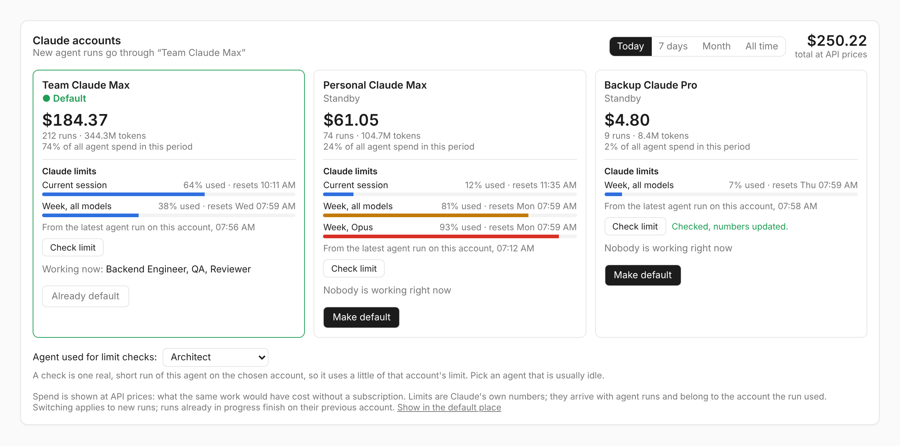

# Claude Accounts for Paperclip

A dashboard widget for [Paperclip](https://github.com/paperclipai/paperclip) teams that run their agents on
**Claude subscriptions** (signed in with a Claude account) rather than API keys.

If you have connected two or three Claude accounts and keep wondering which one your agents are burning
right now, how close each is to its limit, and how to move the team to another account without digging
through settings — this is for you.



*Demo data: the account names, agents and amounts in the screenshot are invented.*

## What you get

For every Claude account connected to the company, one card on the dashboard:

| | |
|---|---|
| **Real usage limits** | Current 5-hour session and weekly windows, as percentages with reset times. These are Claude's own numbers, not an estimate. |
| **Spend at API prices** | What the same work would have cost through the paid API, per account: today, 7 days, this month, all time. Exact, not prorated. |
| **Who is running where** | Which agents have a run in progress on each account right now. |
| **Default account switch** | One click makes an account the default for new agent runs. |
| **"Check limit" button** | Refreshes the limits of an account nobody is using at the moment. |
| **Auto-switch** | Optional. When the default account reaches 90% of a limit, new runs move to the least used account. |

## Requirements

- Paperclip `2026.1106.0` or newer (built and tested on this version).
- At least one Claude connection of the *subscription* kind.
- Node.js 20+ to build.
- For limits and the check button: Paperclip running in its default local mode (see [Limitations](#limitations)).

## Install

```bash
git clone https://github.com/rovshan/paperclip-plugin-claude-accounts.git
cd paperclip-plugin-claude-accounts
npm install
npm run build
npx paperclipai plugin install --local "$(pwd)"
```

Reload the dashboard. Accounts, spend, running agents and the default-account switch work straight away.

To remove it: `npx paperclipai plugin uninstall paperclip-plugin-claude-accounts --force`.

## Real limits: the optional limits patch

Out of the box the limit bars stay empty, and this is why.

Paperclip asks Claude for usage through a separate endpoint. The sign-in Paperclip performs for a
subscription only carries permission to run models, so Claude refuses that request. But Claude *also*
sends the same numbers along with its answers to every agent run. Paperclip's Claude bridge receives
them and throws them away.

The limits patch adds a few lines to that bridge so each report is appended to a local file
(`~/.paperclip/claude-accounts/limits.jsonl`). The plugin reads the file and matches every report to the
account its run used.

```bash
npm run limits:apply     # add the patch
npm run limits:status    # see whether it is in place
npm run limits:revert    # remove it
```

What you should know before running it:

- **It edits a file inside Paperclip's dependencies** (`@agentclientprotocol/claude-agent-acp/dist/acp-agent.js`).
  A backup is kept next to the file, `revert` restores the original text exactly, and the added write is
  wrapped in `try/catch` so it cannot break an agent run.
- **No restart is needed.** The next agent run picks it up.
- **A Paperclip update or reinstall removes it.** Run `npm run limits:apply` again afterwards.
- **If the bridge has changed** and the script does not recognise it, it refuses to patch and tells you.
- If the script cannot find the bridge, pass it explicitly:
  `node scripts/limits-patch.mjs apply --file /path/to/node_modules/@agentclientprotocol/claude-agent-acp/dist/acp-agent.js`

After the patch, limits fill in by themselves as agents run. An account nobody is using shows its last
known numbers, and a window disappears once its reset time has passed.

## The "Check limit" button

Limits arrive only with agent runs, so an idle account has nothing fresh to show. The button fixes that:

1. Below the accounts, choose the **agent used for limit checks**. Pick one that is usually idle.
2. Press **Check limit** on an account.

The plugin pins that agent to the account, starts one ordinary short run of it, and puts the agent back
on its own account when the run ends. Be aware:

- It is a real run, so it uses a little of the checked account's limit.
- If the agent is busy, the check does not start; try again later.
- If the account is exhausted, the run fails and the card shows Claude's error — which is also an answer.
- If Paperclip stops in the middle of a check, the plugin restores the agent's account on next start.

The button needs the limits patch: without it the run happens but nothing records the numbers.

## Auto-switch

Off by default. Tick **Auto-switch at** in the controls row under the accounts to turn it on (hover the **?** marks for what each control does). From then on a background job
runs every 5 minutes, whether or not the dashboard is open:

1. **It looks at the default account.** If its fullest limit window (session, week or a per-model week)
   has reached the threshold — 90% unless you change it — it switches the default to another account.
   At 100% it switches only once the limit is used up, so runs on that account can fail for a few minutes first.
2. **It picks the least used account** among those that are connected, not excluded and below the
   threshold. A window whose reset time has passed counts as empty; an account with no known numbers
   counts as free.
3. **It keeps standby accounts' numbers fresh.** Every 30 or 60 minutes (your choice, or never) it runs
   the same check as the "Check limit" button on a standby account whose numbers are older than that,
   one account per 5-minute pass. This needs a check agent to be chosen.

Good to know:

- Runs already in progress stay on their account; only new runs move.
- After a switch it waits 30 minutes before switching again, and it never switches back by itself.
- If every other account is at the threshold too, it stays put and says so in the widget.
- Each account has a "Skip in auto-switch" box.
- The widget shows the last few switches and when the job last looked.
- It decides only on numbers newer than 30 minutes for the default account. With no agent running there
  is nothing to switch away from.
- Standby checks are real short agent runs: with two standby accounts checked hourly that is about 48
  short runs a day. Set the interval to "never" if you would rather not spend that.
- It needs the limits patch: without it there are no numbers to judge by.

## How the numbers are produced

- **Spend.** Paperclip stores, for every run, the subscription it used and the API-equivalent cost reported
  by Claude Code. The plugin sums those per account for the chosen period. On a subscription none of
  this is actually charged — it shows the value of the work, and what moving to API keys would cost.
- **Limits.** Taken from Claude's `rate_limit_event` messages (`unifiedWindows`): `five_hour`,
  `seven_day` and, when Claude sends them, per-model weekly windows.
- **Running agents and switching.** Paperclip's own API for AI connections.

## What the plugin touches

- Reads two Paperclip tables, read-only: `cost_events` and `heartbeat_runs`.
- Stores in plugin state: the agent chosen for limit checks, the auto-switch settings and its short log.
- Reads and trims `~/.paperclip/claude-accounts/limits.jsonl`; keeps a marker file there during a check.
- Calls Paperclip's local HTTP API. It makes no requests to any other host and sends nothing anywhere.
- For a check, temporarily changes one agent's account binding and restores it.
- With auto-switch on, changes the company's default Claude account when the threshold is reached.

## Limitations

- **Local mode only for limits, checks and auto-switch.** The worker talks to Paperclip's API at
  `http://127.0.0.1:3100` without credentials (override with `PAPERCLIP_API_URL`). On deployments that
  require sign-in for the API, spend still works; limits, the check button and auto-switch do not.
- **Accounts are matched by name** between Paperclip's connections and its subscription records. Two
  connections with the same name will be confused.
- **Dashboard placement.** Paperclip has no setting for widget order. The widget stretches itself to full
  width and, by default, moves the plugin area to the top of the dashboard with CSS. The **Unpin from top**
  link in the controls row switches that off.
- **Unofficial.** Not affiliated with Paperclip or Anthropic. Claude's limit messages are not a documented
  contract and may change.

## Development

```bash
npm run build      # bundles worker, manifest and UI into dist/
npx paperclipai plugin disable paperclip-plugin-claude-accounts
npx paperclipai plugin enable paperclip-plugin-claude-accounts   # reload after a rebuild
```

Source layout: `src/worker.ts` (data, actions and the auto-switch job), `src/ui/index.tsx` (widget),
`src/ui/i18n.ts` (interface text), `scripts/limits-patch.mjs` (the optional patch).

## License

MIT © Rovshan Shirinov
